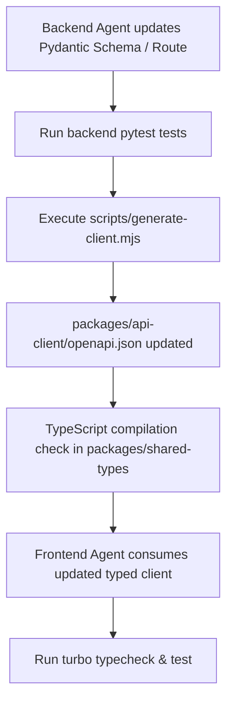

# AGENTS.md — Multi-Agent Engineering Collaboration Protocol

> **Target Audience**: AI coding agents, autonomous subagents, and human software engineers contributing to the Roamly codebase.
> **First Milestone**: December 15, 2026.
> **Monorepo Standard**: pnpm workspaces + Turborepo + FastAPI + Supabase.

---

## 1. Core Operating Principles

1. **OpenAPI as Authoritative Source of Truth**:
   The FastAPI backend (`apps/api`) owns the single source of truth for all API contracts. Frontend clients (`apps/web` and `apps/mobile`) must NEVER invent arbitrary API shapes, mock payload assumptions, or invoke backend endpoints without corresponding OpenAPI schemas.
2. **Zero Secret Keys on Client Apps**:
   `apps/web` and `apps/mobile` run on untrusted user devices. No AI model secrets (e.g. `GEMINI_API_KEY`), Supabase `service_role` keys, or third-party provider credentials may ever exist in client bundles or `.env` files prefixed with `NEXT_PUBLIC_` or `EXPO_PUBLIC_`.
3. **Deterministic Logic Stays Deterministic**:
   LLMs must never perform financial arithmetic, budget additions, or date difference calculations. Deterministic domain logic belongs in `@roamly/shared-utils` (TypeScript) and `app/services/budget_service.py` (Python) using integer-cent arithmetic.
4. **Boundary Isolation**:
   Coding agents assigned to frontend ownership must not alter database models or backend business logic. Coding agents assigned to backend ownership must not alter React components or mobile views. Shared contracts require a formal transition step.

---

## 2. Area Ownership & Scopes

```text
apps/web/               ─── Owned by: Frontend Coding Agent
apps/mobile/            ─── Owned by: Frontend Coding Agent
packages/design-tokens/ ─── Co-owned: Frontend Agent (lead) & Design Lead
packages/shared-types/  ─── Shared Contract Policy (OpenAPI-derived)
packages/shared-utils/  ─── Shared Engineering Utility
packages/api-client/    ─── Generated Artifact (Automated from apps/api)
apps/api/               ─── Owned by: Backend Coding Agent
docs/                   ─── Co-owned: Principal Architect / Lead Engineer
```

### Frontend Coding Agent Responsibilities
- Owns Next.js 15 App Router web interface (`apps/web`).
- Owns React Native / Expo Router mobile interface (`apps/mobile`).
- Consumes `@roamly/api-client` for all data fetching and mutations.
- Consumes `@roamly/design-tokens` for color palettes, spacing, and typography.
- Consumes `@roamly/shared-utils` for currency formatting and date displays.
- Must ensure responsive web design (desktop down to mobile viewports) and platform-appropriate mobile navigation (iOS and Android).
- Must never write direct raw database queries or direct third-party provider calls.

### Backend Coding Agent Responsibilities
- Owns FastAPI application, routers, services, and repositories (`apps/api`).
- Owns SQLAlchemy 2 database models and Alembic migrations.
- Owns provider gateway abstractions and fallbacks (`apps/api/app/providers/`).
- Owns LangGraph agent graph definitions and state schemas (`apps/api/app/workflows/`).
- Owns Server-Sent Events (SSE) progress streaming endpoints (`/api/v1/agents/runs/{id}/stream`).
- Ensures all endpoints conform to typed Pydantic v2 schemas and export clean OpenAPI metadata.
- Ensures the health check endpoint `/health` functions regardless of production database connectivity.

---

## 3. Protocol for Shared-Contract Changes

When an agent needs to add or modify an API endpoint, data model, or schema:



1. **Step 1: Backend Implementation**:
   - Backend agent modifies or creates Pydantic v2 schemas in `apps/api/app/schemas/`.
   - Update router in `apps/api/app/api/v1/`.
   - Run backend tests: `python -m pytest apps/api/tests`.
2. **Step 2: OpenAPI Contract Sync**:
   - Run `node scripts/generate-client.mjs` (or `python scripts/export_openapi.py`).
   - This regenerates `packages/api-client/openapi.json`.
3. **Step 3: Verification**:
   - Run `pnpm run typecheck` across all workspace projects.
   - Any breaking change will be caught immediately at compile time.
4. **Step 4: Frontend Adoption**:
   - Frontend agent updates caller components in `apps/web` or `apps/mobile`.
   - No guesswork or manual TypeScript interface duplication.

---

## 4. Coding Standards & Guidelines

### TypeScript / Frontend
- **Strict Typing**: No `any`. Use discriminated unions, strict null checks, and explicit function return types.
- **Components**: Functional components only. Use React 19 / Server Components in Next.js where appropriate; mark client interactivity with `'use client'`.
- **Styling**: Tailwind CSS classes mapped to tokens. Do not hardcode hex color codes directly in components; use `bg-emerald-600`, `text-neutral-900`, or design tokens.
- **Directory Structure**:
  - `components/ui/` for primitive atomic components (Button, Card, Badge, Input).
  - Feature components organized by domain (`components/itinerary/`, `components/budget/`).

### Python / Backend
- **Type Annotations**: Strict typing with Python 3.11+ union syntax (`str | None`, `list[dict]`).
- **Pydantic v2**: Use `model_config = SettingsConfigDict(...)` and `Field(...)` with validations.
- **SQLAlchemy 2.0**: Always use `Mapped[...]` and `mapped_column(...)`. No legacy `Column(...)` syntax.
- **Async First**: All endpoint handlers and repository operations must be `async def`.
- **Database Access**: Never execute raw SQL in endpoints. All DB access flows through Repositories injected into Services.

---

## 5. Environment Variables & Secret Hygiene

- **Rule**: Never commit `.env`, `.env.local`, or any file containing unmasked API keys or credentials.
- **Template Files**: Maintain accurate `.env.example` in:
  - Repository root: `/.env.example`
  - Web: `/apps/web/.env.example`
  - Mobile: `/apps/mobile/.env.example`
  - Backend: `/apps/api/.env.example`
- **Prefix Isolation**:
  - `NEXT_PUBLIC_*`: Exposed in web browser bundle.
  - `EXPO_PUBLIC_*`: Exposed in mobile client bundle.
  - Non-prefixed variables: Strictly server-side in `apps/api`.

---

## 6. Git Branching & Commit Conventions

- `main`: Production release branch. Protected.
- `develop`: Primary staging and integration branch.
- Feature branches:
  - `feat/web-<feature-name>`: Web-specific frontend work.
  - `feat/mobile-<feature-name>`: Mobile-specific frontend work.
  - `feat/api-<feature-name>`: Backend API and provider work.
  - `feat/contract-<name>`: Cross-cutting shared contract updates.
- Commit messages follow Conventional Commits:
  - `feat(api): add itinerary routing endpoint`
  - `fix(web): correct budget calculation card display`
  - `chore(contract): update openapi client schema`
