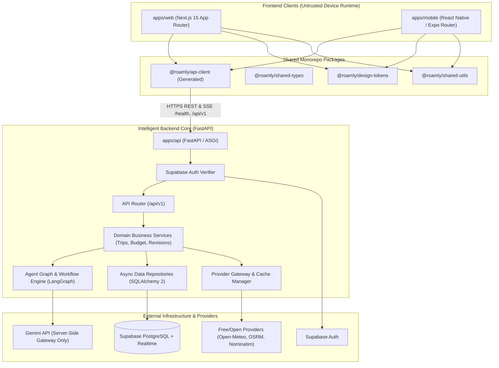

# System Architecture & Technical Specifications

> **Product**: Roamly — Autonomous AI Travel Operating System
> **Target Production Milestone**: December 15, 2026
> **Architecture Paradigm**: Monorepo with Thin Client Frontends and an Intelligent Core Backend

---

## 1. System Components & Topology

The Roamly platform is structured as a unified monorepo supporting two user-facing frontend client shells and a single central Python backend orchestrator.



---

## 2. End-to-End Data Flow

### 2.1 Request Lifecycle: Trip Creation & Exploration
1. **User Action**: The traveler inputs initial parameters (destination or budget ceiling, dates, party size, travel vibe) on Web or Mobile.
2. **Client Dispatch**: The client calls `@roamly/api-client.createTrip()`, passing a structured payload with the user's Supabase JWT in the `Authorization: Bearer` header.
3. **Gateway Ingestion**: FastAPI receives the request at `/api/v1/trips`. The authentication dependency validates the JWT.
4. **Service Execution**:
   - `TripService` validates date sequences (`start_date <= end_date`).
   - Resolves geographical coordinates via `PlacesProvider` (or Nominatim / mock fixture).
   - Creates a new `Trip` record with status `draft`.
   - Creates `TripRevision` #1 with an immutable snapshot of input constraints.
5. **Deterministic Budget Initialization**:
   - `BudgetService` initializes category allocation buckets (transportation: 30%, lodging: 35%, activities: 15%, dining: 15%, contingency: 5%) using integer-cent arithmetic.
   - Computes a deterministic SHA-256 checksum verifying the allocation integrity.
6. **Response Delivery**:
   - FastAPI returns the typed `TripResponse` wrapped in standard `ApiResponseEnvelope`.
   - The client UI updates optimistically with trip details and budget gauges.

### 2.2 Agentic Execution & Progress Streaming
1. When planning is initiated, the backend launches an asynchronous LangGraph workflow.
2. The client establishes a Server-Sent Events (SSE) connection to `/api/v1/agents/runs/{run_id}/stream`.
3. As logical agents (Destination Discovery, Transport, Lodging, Routing, Weather, Budget) execute stages, events are published to `AgentEventPublisher`.
4. SSE events stream to the client in real time:
   ```json
   {
     "id": "evt-812739",
     "runId": "run-019238",
     "agentRole": "weather_wardrobe",
     "stepNumber": 4,
     "stageName": "Synthesizing packing advice",
     "status": "in_progress",
     "message": "Analyzing precipitation forecast for Kyoto (15% chance of light rain).",
     "timestamp": "2026-11-13T22:30:00Z"
   }
   ```
5. If an intermediate parameter changes (e.g. user updates travel dates), `ReplanningDependencyGraph` calculates which agents are invalidated and restarts execution only for affected nodes.

---

## 3. Strict Boundary Enforcements

### 3.1 Web & Mobile Boundaries
- **No Secret Storage**: Never include third-party API keys or LLM tokens in frontend environment variables.
- **No Direct LLM Invocations**: Frontend apps never call AI endpoints directly. All intelligence is brokered by FastAPI.
- **No Direct DB Access**: Frontend code never connects directly to PostgreSQL via raw SQL or administrative drivers. Read/write access flows through FastAPI endpoints or Supabase RLS-governed client queries.

### 3.2 Backend & Provider Boundaries
- **Provider Decoupling**: Business services (`TripService`, `BudgetService`) never import provider-specific SDKs. All external lookups go through `BasePlacesProvider`, `BaseWeatherProvider`, etc.
- **Provenance Tagging**: Every piece of provider data returned to the database or UI carries provenance metadata (`source: live_provider | cached_provider | deterministic_estimate | fixture_mock`).
- **Offline / Mock Fallback**: In early development or when external API quotas are exhausted, providers seamlessly fall back to local mock fixtures without throwing runtime exceptions.

---

## 4. Deployment Architecture

```text
                  ┌───────────────────────────────────┐
                  │          Cloudflare DNS           │
                  └─────────────────┬─────────────────┘
                                    │
           ┌────────────────────────┴────────────────────────┐
           ▼                                                 ▼
┌───────────────────────┐                         ┌───────────────────────┐
│     Vercel Edge       │                         │    Railway / Render   │
│  (Next.js App Router) │                         │   (FastAPI Container) │
│   web.roamly.com      │                         │     api.roamly.com    │
└───────────────────────┘                         └───────────┬───────────┘
                                                              │
                                            ┌─────────────────┴─────────────────┐
                                            ▼                                   ▼
                                 ┌─────────────────────┐             ┌─────────────────────┐
                                 │ Supabase PostgreSQL │             │   Gemini API / LLM  │
                                 │  (Managed Database) │             │ (Server Gateway)    │
                                 └─────────────────────┘             └─────────────────────┘
```

- **Web Deployment**: Deployed to Vercel as a standard Next.js App Router application with automatic ISR, edge caching, and asset minification.
- **Mobile Deployment**: Built via Expo Application Services (EAS) targeting iOS TestFlight and Android Google Play internal testing.
- **Backend Deployment**: Packaged as a lightweight Docker container running Uvicorn ASGI workers behind Gunicorn or direct Uvicorn on Railway / Render.
- **Database**: Managed Supabase PostgreSQL with automated daily backups and SSL connection pooling via PgBouncer.

---

## 5. Security & Isolation Boundaries

1. **Authentication**: Supabase Auth handles email/password, magic links, and OAuth. The FastAPI backend verifies the Supabase JWT using public key verification on protected endpoints.
2. **Row-Level Security (RLS)**: PostgreSQL tables have RLS policies ensuring users can only read or mutate trips they own or groups they have joined.
3. **CORS Governance**: FastAPI enforces strict CORS origins (`API_CORS_ORIGINS`) allowing only authenticated requests from the verified Web and Expo mobile origins. Wildcard `*` origins are forbidden in production.
4. **Rate Limiting & Quotas**: Backend middleware limits incoming client requests and enforces a strict token budget on upstream LLM and provider calls.
