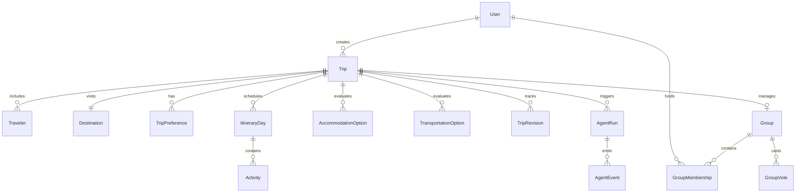

# Data Models & Persistence Strategy

> **Database**: Supabase PostgreSQL 15+ / Local SQLite for early development
> **ORM**: SQLAlchemy 2.0 (Async) + Alembic
> **Target Schema Version**: `0.1.0`

---

## 1. Domain Entities & Entity-Relationship Model

---

## 2. Core Entities Specification

### 2.1 User & Traveler
- **User**:
  - `id` (UUID): Maps directly to Supabase Auth (`auth.users.id`).
  - `email` (string, unique): Primary contact email.
  - `full_name` (string, optional): Display name.
  - `avatar_url` (string, optional): Profile picture URL.
  - `preferred_currency` (string, ISO 4217): Default currency for budgeting (e.g. `USD`, `EUR`).
  - `locale` (string): e.g. `en-US`.
- **Traveler**:
  - Represents an individual participating in a specific trip. Supports non-registered family members/friends.
  - `id` (UUID)
  - `trip_id` (UUID, FK -> `trips.id`)
  - `user_id` (UUID, optional, FK -> `users.id`): If linked to a registered account.
  - `name` (string)
  - `age_category` (enum: `adult`, `teen`, `child`, `infant`)
  - `dietary_restrictions` (JSON string array): e.g. `["vegetarian", "gluten_free"]`.
  - `mobility_needs` (JSON string array): e.g. `["wheelchair_accessible", "limited_stairs"]`.

### 2.2 Trip & Destination
- **Trip**:
  - Root aggregate entity for all travel planning.
  - `id` (UUID)
  - `creator_id` (UUID, FK -> `users.id`)
  - `title` (string, max 120 chars)
  - `description` (string, optional)
  - `status` (enum: `draft`, `planning`, `proposed`, `confirmed`, `active`, `completed`, `archived`)
  - `start_date` (Date, ISO 8601)
  - `end_date` (Date, ISO 8601)
  - `destination_id` (UUID, FK -> `destinations.id`)
  - `party_size` (integer, default 1)
  - `total_budget_amount` (Float, optional)
  - `total_budget_currency` (string, ISO 4217)
  - `current_revision_id` (UUID)
- **Destination**:
  - Normalized geographical entity.
  - `id` (UUID)
  - `name` (string): City or municipality name (e.g. "Kyoto").
  - `country` (string): Country name or ISO alpha-2.
  - `region` (string, optional): Prefecture/State/Province.
  - `latitude` (Float) & `longitude` (Float)
  - `timezone` (string): IANA timezone string (e.g. "Asia/Tokyo").

### 2.3 TripPreference
- Captures traveler vibe, constraints, and operational preferences.
- `id` (UUID)
- `trip_id` (UUID, FK -> `trips.id`)
- `pace` (enum: `relaxed`, `balanced`, `fast_paced`)
- `budget_tier` (enum: `ultra_budget`, `budget`, `moderate`, `upscale`, `luxury`)
- `interests` (JSON string array): e.g. `["history", "food", "hiking", "art"]`.
- `avoid_categories` (JSON string array): e.g. `["crowds", "nightclubs"]`.
- `max_daily_walking_hours` (Float)
- `accessibility_needs` (JSON string array)

### 2.4 ItineraryDay & Activity
- **ItineraryDay**:
  - `id` (UUID)
  - `trip_id` (UUID, FK -> `trips.id`)
  - `day_number` (integer, 1-indexed)
  - `date` (Date)
  - `theme_title` (string, optional): e.g. "Historic Temples & Gion Evening".
  - `weather_summary` (JSON, optional): Cached snapshot of temperature, conditions, and clothing advice.
- **Activity**:
  - Scheduled experience or point-of-interest.
  - `id` (UUID)
  - `itinerary_day_id` (UUID, FK -> `itinerary_days.id`)
  - `name` (string)
  - `category` (enum: `sightseeing`, `culture`, `food_and_drink`, `outdoor_adventure`, `relaxation`, `shopping`)
  - `start_time` & `end_time` (string, HH:mm format)
  - `duration_minutes` (integer)
  - `location_name` (string)
  - `latitude` & `longitude` (Float)
  - `estimated_cost_amount` (Float) & `estimated_cost_currency` (string)
  - `booking_required` (boolean) & `booking_url` (string, optional)
  - `order_index` (integer): Display order within the day.
  - `provenance_metadata` (JSON): Source, confidence score, and timestamp.

### 2.5 AccommodationOption & TransportationOption
- **AccommodationOption**:
  - `id` (UUID), `trip_id` (UUID)
  - `name` (string), `type` (enum: `hotel`, `hostel`, `apartment`, `resort`, `guesthouse`)
  - `check_in_date` & `check_out_date` (Date)
  - `price_per_night` & `total_price` (Float), `currency` (string)
  - `selected` (boolean): Whether actively committed into the budget.
  - `rating` (Float), `amenities` (JSON string array)
  - `provenance_metadata` (JSON)
- **TransportationOption**:
  - `id` (UUID), `trip_id` (UUID)
  - `mode` (enum: `flight`, `train`, `bus`, `drive`, `ferry`, `subway`)
  - `departure_time` & `arrival_time` (ISO 8601 strings)
  - `origin_name` & `destination_name` (string)
  - `carrier_or_provider` (string, optional)
  - `estimated_cost_amount` (Float), `currency` (string)
  - `selected` (boolean)
  - `provenance_metadata` (JSON)

### 2.6 BudgetBreakdown
- Structured summary calculated deterministically.
- `id` (UUID), `trip_id` (UUID)
- `currency` (string)
- `total_budget`, `total_estimated_cost`, `total_actual_cost`, `remaining_estimated_budget`
- `categories` (JSON): Array of `CategoryBudget` with allocated, estimated, actual, and status (`on_track`, `warning`, `exceeded`).
- `deterministic_checksum` (string, SHA-256 digest): Proves calculations were executed by deterministic arithmetic, not LLM hallucination.

### 2.7 Group, GroupMembership & GroupVote
- **Group**:
  - `id` (UUID), `trip_id` (UUID, 1-to-1)
  - `name` (string), `invite_code` (string, unique alphanumeric)
- **GroupMembership**:
  - `id` (UUID), `group_id` (UUID), `user_id` (UUID)
  - `role` (enum: `owner`, `organizer`, `traveler`, `viewer`)
- **GroupVote**:
  - `id` (UUID), `group_id` (UUID)
  - `target_type` (enum: `destination`, `activity`, `accommodation`, `transportation`)
  - `target_id` (UUID)
  - `user_id` (UUID)
  - `vote` (enum: `up`, `down`, `abstain`)
  - `notes` (string, optional)

### 2.8 AgentRun & AgentEvent
- **AgentRun**:
  - `id` (UUID), `trip_id` (UUID), `orchestrator_run_id` (UUID, optional)
  - `agent_role` (string), `status` (string: `pending`, `running`, `completed`, `failed`)
  - `input_payload` (JSON), `output_payload` (JSON), `error` (string, optional)
  - `execution_duration_ms` (integer), `model_identifier` (string, optional)
- **AgentEvent**:
  - `id` (UUID), `run_id` (UUID)
  - `agent_role` (string), `step_number` (integer), `stage_name` (string)
  - `status` (string), `message` (string), `metadata` (JSON), `timestamp` (DateTime)

---

## 3. Data Ownership & Security Boundaries

1. **Owner Isolation**: Trips are owned by the `creator_id`. Only the creator or authorized members of the associated `Group` have access.
2. **Row-Level Security (RLS)**:
   - Supabase RLS policies enforce `auth.uid() = creator_id` for personal trips.
   - For group trips, policies verify membership via `group_memberships.user_id = auth.uid()`.
3. **Immutability of Historical Snapshots**:
   - `TripRevision` entries are append-only. They are never updated or deleted.

---

## 4. Trip Revision Strategy

Whenever a trip is altered—whether by direct user modification, group vote outcome, or agent replanning:
1. A new `TripRevision` row is inserted.
2. `revision_number` increments (`N + 1`).
3. `trigger_source` records origin (`user_edit`, `agent_replan`, `provider_update`, `group_vote`).
4. `snapshot_data` preserves a complete JSON representation of the trip state at that moment.
5. `current_revision_id` on the `Trip` record updates to point to the new revision.
6. This enables instant undo, visual diffing between versions, and transparent agent auditability.
