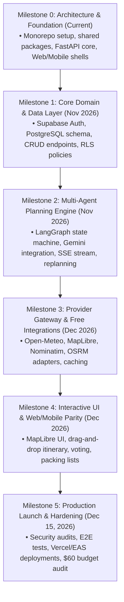

# Product & Engineering Roadmap: 2026

> **Target Release Milestone**: December 15, 2026
> **Maturity Goal**: Production-grade, cross-platform AI travel operating system with commercial viability

---

## 1. Development Phases & Milestones

---

## 2. Milestone Detailed Breakdown

### Milestone 0: Monorepo Foundation & Tooling (COMPLETED)
- [x] Turborepo + pnpm workspaces architecture.
- [x] Shared TypeScript packages (`design-tokens`, `shared-types`, `shared-utils`, `api-client`).
- [x] FastAPI backend with `/health` and `/api/v1` router structure.
- [x] Deterministic budget service with integer-cent math and checksums.
- [x] Next.js 15 App Router web shell with landing page, dashboard, and system status indicator.
- [x] Expo / React Native mobile shell with navigation and shared package demonstration.
- [x] Automated test suites (pytest for API, vitest for shared utilities, typecheck for monorepo).
- [x] Client generation script from FastAPI OpenAPI specification.

### Milestone 1: Authentication, Data Persistence & RLS (Target: Nov 22, 2026)
- [ ] Connect Supabase PostgreSQL instance and apply Alembic migrations.
- [ ] Implement Supabase Auth (Email magic link + Google OAuth).
- [ ] Add Row-Level Security (RLS) policies for personal trips and group access.
- [ ] Implement full CRUD endpoints for Trips, Itinerary Days, and Activities.
- [ ] Implement append-only `TripRevision` audit log.

### Milestone 2: LangGraph Orchestration & Gemini Integration (Target: Nov 29, 2026)
- [ ] Construct the `TravelPlanState` LangGraph graph in `apps/api/app/workflows/`.
- [ ] Implement Destination Discovery, Itinerary Routing, and Weather/Wardrobe agent nodes.
- [ ] Integrate Gemini API Flash model with Pydantic tool calling.
- [ ] Connect real-time Server-Sent Events (SSE) stream to `/api/v1/agents/runs/{id}/stream`.
- [ ] Implement `ReplanningDependencyGraph` for localized automatic replanning.

### Milestone 3: Provider Gateway & Mapping (Target: Dec 06, 2026)
- [ ] Connect live Open-Meteo API for multi-day weather forecasts.
- [ ] Connect OpenStreetMap Nominatim for POI geocoding with 1 req/sec rate limit.
- [ ] Implement MapLibre GL JS interactive map view in Web (`apps/web`).
- [ ] Implement route polyline visualization between daily itinerary activities.
- [ ] Verify circuit breaker fallbacks to mock fixtures when offline or rate-limited.

### Milestone 4: Group Collaboration & UI Parity (Target: Dec 11, 2026)
- [ ] Implement Group Invitations with unique alphanumeric codes.
- [ ] Add Group Voting on destinations, activities, and accommodations.
- [ ] Supabase Realtime synchronization for concurrent group itinerary updates.
- [ ] Achieve full feature parity between Next.js Web and Expo Mobile.

### Milestone 5: Hardening, E2E Testing & Launch (Target: December 15, 2026)
- [ ] Playwright E2E test suite covering full trip planning and budget validation flow.
- [ ] Mobile smoke tests on iOS Simulator and Android Emulator.
- [ ] Deployment to Vercel (Web) and EAS build (Mobile).
- [ ] Production cost verification confirming $0 recurring spend and spend < $60 ceiling.

---

## 3. Web & Mobile Parity Matrix

| Feature | Web App (`apps/web`) | Mobile App (`apps/mobile`) | Shared Codebase |
|---|---|---|---|
| **Authentication** | Supabase Web Auth | Supabase React Native Auth | Shared Token Protocol |
| **Trip Creation** | Responsive Modal / Form | Native Bottom Sheet | `@roamly/api-client` |
| **Interactive Map** | MapLibre GL JS | React Native MapLibre | `@roamly/shared-types` |
| **Itinerary Editing** | Drag & Drop Day Schedule | Reorderable List View | `@roamly/shared-utils` |
| **Budget Breakdown** | Multi-category Bar Chart | Summary Card & Progress Bars | `@roamly/shared-utils` |
| **Agent Telemetry** | Animated SSE Drawer | Bottom Modal Progress Bar | `@roamly/api-client` |
| **Weather & Wardrobe** | Visual Outfit Carousel | Outfit Card Swiper | `@roamly/design-tokens` |
